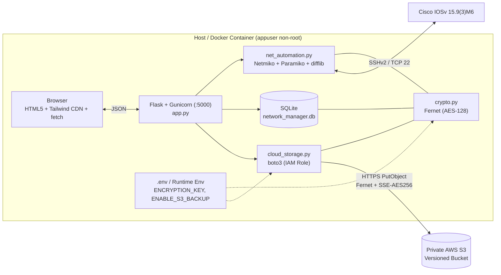
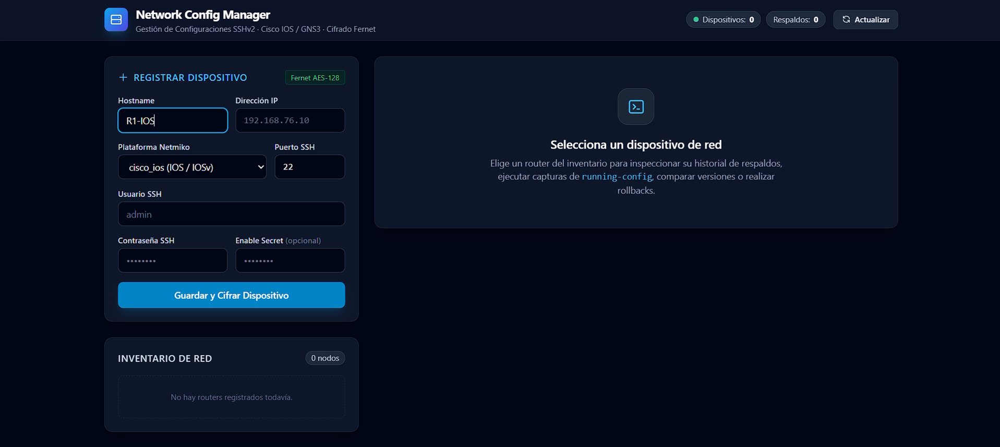
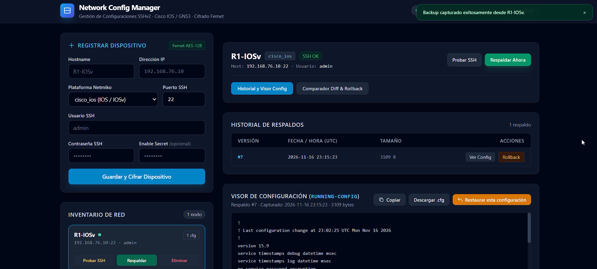
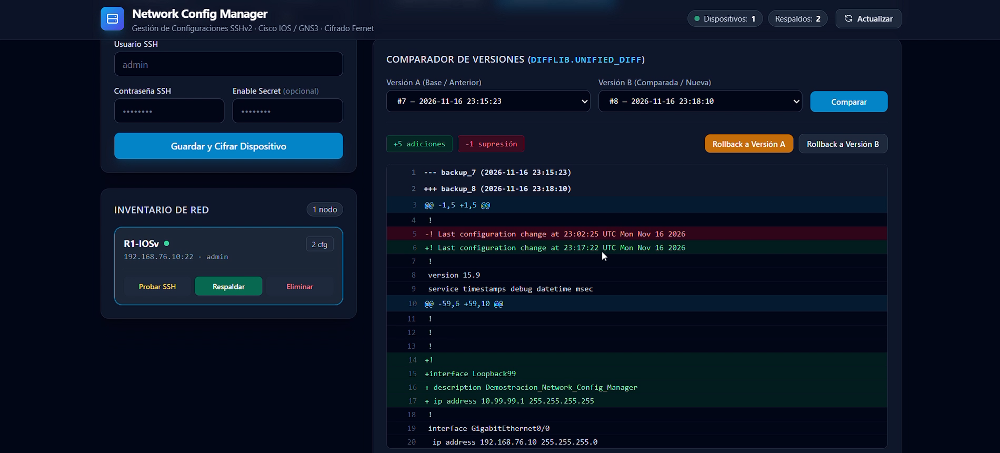

<div align="center">

# 🛰️ Network Config Manager

**Automated configuration management for Cisco IOS / IOSv devices: SSHv2 backups, diff auditing, controlled rollback, and encrypted-at-rest credentials with optional AWS S3 hybrid replication.**


-2E7D32)


-2088FF?logo=githubactions&logoColor=white)

M6-049fd9?logo=cisco&logoColor=white)


</div>

---

## 1. Executive Summary

**Network Config Manager** is a NetDevOps / SRE web application built to manage the configuration lifecycle of **Cisco IOS / IOSv** routers and switches, engineered for hardened container deployment and automated CI validation. From a single web console, operators can:

- **Manage Device Inventory:** Register network devices while storing SSH passwords and *enable secrets* **encrypted at rest with Fernet** (never in plaintext).
- **Execute Hybrid Backups (Local SQLite + AWS S3):** Capture the live `running-config` over **SSHv2** (Netmiko/Paramiko), persist locally in SQLite first, and—when `ENABLE_S3_BACKUP=true`—automatically replicate a **double-encrypted** copy (client-side Fernet AES-128 + server-side SSE-S3 `AES256`) to a private **AWS S3** bucket using **IAM Roles** only (with graceful degradation if S3 is unavailable).
- **Audit Configuration Drift:** Compare any two backup versions with a backend-computed unified diff (`difflib`) rendered with line-by-line color highlighting in the browser.
- **Perform Controlled Rollbacks:** Push a previous configuration snapshot back to the live router with explicit modal confirmation and NVRAM persistence (`write memory`).
- **Deploy & Validate Reliably:** Packaged in a **hardened Docker container** (`python:3.12-slim`, non-root `appuser`, Gunicorn `--preload`) and validated on every push/PR via **GitHub Actions CI** (`ruff` $\rightarrow$ `unittest` $\rightarrow$ `docker build`).

The project adheres to strict architectural governance ([`RULES.md`](RULES.md) and [`ARCHITECTURE.md`](ARCHITECTURE.md)): zero-build frontend, parameterized SQL queries, zero hardcoded secrets, and explicit network error handling.

---

## 2. Architecture & Key Features



### 🔐 Credential Encryption at Rest
- `encrypted_password` and `encrypted_secret` are stored as **Fernet** tokens (AES-128-CBC + HMAC-SHA256) via [`crypto.py`](crypto.py).
- The master key `ENCRYPTION_KEY` resides **only** in `.env` or runtime environment variables (excluded via `.gitignore`); the repository only ships [`.env.example`](.env.example).
- Passwords are decrypted **in volatile memory** immediately before opening an SSH session and explicitly cleared in `finally`.
- The REST API **never** exposes passwords or secrets—neither plaintext nor encrypted.
- `enable secret` is **optional** per device.

### ⚙️ SSHv2 Network Automation Engine (`net_automation.py`)
- Connects via `ConnectHandler` (`device_type="cisco_ios"` by default), `fast_cli=False`, and `clear_buffer()` before running commands.
- **Tuned Timeouts for Real IOSv (QEMU):** `timeout`, `conn_timeout`, `auth_timeout`, and `banner_timeout` set to 30 s, `read_timeout_override` = 30 s, `global_delay_factor` = 2.0; `show running-config` uses `read_timeout=30` and `send_config_set` uses `read_timeout=60`.
- **Privilege Elevation:** `enable()` is only invoked when `not conn.check_enable_mode()`; `privilege 15` users (landing directly on `#`) never hang waiting for an enable prompt.
- **Cisco IOSv 15.9(3)M6 SSH Compatibility:** This IOS image only offers legacy SHA-1 algorithms (`diffie-hellman-group14-sha1`, `ssh-rsa` host key). Newer Paramiko releases removed SHA-1 KEX/host keys (verified with 5.1.0 failing with *"no acceptable kex algorithm"*), so this project pins **Paramiko 3.5.1** and sets `disabled_algorithms={"pubkeys": ["rsa-sha2-256", "rsa-sha2-512"]}`.
- **Public Functions:** `test_connection()`, `fetch_running_config()` (strips volatile `Building configuration...` and `Current configuration : ... bytes` headers), `apply_configuration()` (`send_config_set()` + `save_config()`), and `calculate_diff()`.
- **Explicit Error Handling:** Catches `NetmikoAuthenticationException`, `NetmikoTimeoutException` (preserving original Netmiko details), and transport failures (`socket.error`, `OSError`, `EOFError`, `NetmikoBaseException`, and Paramiko `SSHException`) $\rightarrow$ `ConnectionError`. No credentials ever leak into logs or error payloads.

### 🗄️ Persistence & Hybrid AWS S3 Backup (`cloud_storage.py`)
- **Local-First SQLite:** Pure `sqlite3` with `PRAGMA foreign_keys = ON`, **parameterized queries (`?`)**, and idempotent schema migrations (`encrypted_secret`, `port` in `devices`; `s3_key`, `s3_version_id` in `backups`). Supports configurable `DB_PATH`.
- **Double Encryption to AWS S3:** When `ENABLE_S3_BACKUP=true`, [`cloud_storage.py`](cloud_storage.py) encrypts `raw_config` in memory with **Fernet (AES-128)** prior to upload (`crypto.encrypt_password()`) and uploads with **SSE-S3 (`ServerSideEncryption="AES256"`)** to `backups/{hostname}/{timestamp}_backup_{backup_id}.enc`, recording `s3_key` and `VersionId` in SQLite.
- **Zero Hardcoded Credentials (IAM Roles):** `boto3.client("s3", region_name=...)` relies exclusively on the standard AWS credential chain (IAM Instance Profile, ECS Task Role, IRSA, or standard AWS environment); `aws_access_key_id` and `aws_secret_access_key` never appear in code.
- **Graceful Degradation:** If `ENABLE_S3_BACKUP=false` (default), `AWS_S3_BUCKET` is unset, or AWS raises `ClientError`, `NoCredentialsError`, or `BotoCoreError`, the local SQLite backup remains intact and the API returns `201 Created` with a `cloud_sync` status object instead of an HTTP `500`.

### 🔍 Diff Comparator & Rollback
- Backend `difflib.unified_diff(..., lineterm="")` with `\r\n` $\rightarrow$ `\n` normalization.
- The UI highlights additions (`+`, green), deletions (`-`, red), hunk headers (`@@`, blue), and displays change counters.
- Rollback actions require confirmation in a native `<dialog>` modal and display CLI execution output alongside toast notifications.

### 🎨 Zero-Build Frontend
- Semantic HTML5 (`header`, `main`, `section`, `article`, `nav`, `dialog`, `table`, `form`), **Tailwind CSS via CDN**, and vanilla JavaScript with **Fetch API**—no Node.js, npm, bundlers, or UI frameworks.
- DOM updates use `textContent`/`createElement` to prevent XSS. Includes S3 sync badges, monospace config viewer, clipboard copy, and `.cfg` file download.

### 🐳 Hardened Container & CI Pipeline
- **Docker (`Dockerfile` + `.dockerignore`):** Built on `python:3.12-slim`, runs **Gunicorn** (`--preload -w 2 -b 0.0.0.0:5000 app:app`) as non-root `appuser` with a writable `/app/data` directory for SQLite, excluding `.env`, `*.db`, and `venv/`.
- **GitHub Actions (`.github/workflows/ci.yml`):** On every `push` or `pull_request` to `main`, runs three chained jobs: `lint` (`ruff check .`) $\rightarrow$ `test` (`unittest` with an ephemeral `ENCRYPTION_KEY`) $\rightarrow$ `docker-build` (`docker build`).

---

## 3. Tech Stack

| Layer | Technology | Validated Version |
| :--- | :--- | :--- |
| Language | Python | 3.12.10 (`python:3.12-slim`) |
| Web Server / WSGI | Flask / Gunicorn (Werkzeug / Jinja2) | 3.1.3 / 27.0.1 |
| Network Automation | Netmiko | 4.8.0 |
| SSH Transport | Paramiko | **3.5.1** (pinned for Cisco IOSv compatibility) |
| Cryptography | `cryptography` (Fernet) | 50.0.2 |
| Cloud Storage | AWS S3 (`boto3`, IAM Roles, SSE-AES256) | 1.44.11 |
| Environment Config | python-dotenv | 1.2.4 |
| Persistence | SQLite (`sqlite3` standard library) | — |
| Diff Engine | `difflib` (standard library) | — |
| Frontend | HTML5 + Tailwind CSS (CDN) + Vanilla JS | — |
| Linting / CI | Ruff + GitHub Actions | 0.17.6 |
| Containerization | Docker (non-root `appuser`) | — |
| Testing | `unittest` + `unittest.mock` | — |

### Validated Lab Environment
- **GNS3** (Windows client) + **GNS3 VM** on **VMware Workstation**.
- **Cisco IOSv 15.9(3)M6** reachable at `192.168.76.10`, SSHv2 on port 22, `privilege 15` local user.

<details>
<summary>Reference Router Preparation (Cisco IOS)</summary>

```
hostname R1
ip domain-name lab.local
crypto key generate rsa modulus 2048
ip ssh version 2
username admin privilege 15 secret <password>
enable secret <secret>
line vty 0 4
 login local
 transport input ssh
```
</details>

---

## 4. Repository Structure

```text
network-config-manager/
├── .github/
│   └── workflows/
│       └── ci.yml            # CI pipeline: lint (ruff) -> test (unittest) -> docker-build
├── app.py                    # Flask server & REST API (port 5000)
├── cloud_storage.py          # Hybrid AWS S3 backup (Fernet + SSE-AES256, IAM Role)
├── database.py               # SQLite DAL (parameterized queries, idempotent migrations)
├── net_automation.py         # Netmiko/Paramiko: test, backup, apply_configuration, difflib
├── crypto.py                 # Fernet encrypt/decrypt (reads ENCRYPTION_KEY from .env)
├── templates/
│   └── index.html            # Web UI (HTML5 + Tailwind CDN + Vanilla JS + S3 badge)
├── docs/
│   └── images/               # End-to-end demonstration screenshots (5 PNGs)
├── test_api.py               # Flask API integration tests (9)
├── test_cloud_storage.py     # AWS S3 mocked unit tests & graceful degradation (11)
├── test_db_crypto.py         # Persistence, encryption & migration tests (9)
├── test_net_automation.py    # Mocked network automation & diff tests (17)
├── test_db.py                # Quick SQLite + Fernet verification script
├── Dockerfile                # Hardened python:3.12-slim + appuser + Gunicorn --preload
├── .dockerignore             # Excludes .env, *.db, venv/, __pycache__/, and .git/
├── requirements.txt          # Pinned dependencies (paramiko==3.5.1, boto3, gunicorn, ruff)
├── ruff.toml                 # Ruff static analysis config (py312)
├── ARCHITECTURE.md           # Topology, data model, contracts, and execution flow
├── RULES.md                  # Technical governance rules
├── .env.example              # Environment variable template (Fernet + AWS S3)
├── .gitignore                # Excludes .env, *.db, venv/, and __pycache__/
├── .specify/                 # Spec Kit templates and core specs
│   └── specs/
│       ├── 01-database-and-inventory.md
│       └── 02-network-automation.md
├── specs/                    # SRE/Cloud evolution spec, plan, and tasks
│   └── 001-sre-cloud-evolution/
│       ├── spec.md
│       ├── plan.md
│       └── tasks.md
└── .agents/skills/           # Spec Kit AI assistant skills
```

Locally generated and **untracked** files: `.env`, `network_manager.db`, and `venv/`.

---

## 5. Local Installation & Execution

> Prerequisites: **Python 3.12** and **Git**.

### Windows (PowerShell)

```powershell
# 1. Clone and enter the repository
git clone https://github.com/mgc-cloud17/network-config-manager.git
cd network-config-manager

# 2. Virtual environment (if PowerShell blocks activation: Set-ExecutionPolicy -Scope Process Bypass)
python -m venv venv
.\venv\Scripts\Activate.ps1

# 3. Install pinned dependencies
python -m pip install --upgrade pip
pip install -r requirements.txt

# 4. Generate Fernet ENCRYPTION_KEY into .env from .env.example
Copy-Item .env.example .env
$key = python -c "from cryptography.fernet import Fernet; print(Fernet.generate_key().decode())"
(Get-Content .env) -replace 'genera_tu_propia_llave_fernet_aqui', $key | Set-Content .env -Encoding ascii

# 5. Run tests
python -m unittest discover -s . -p "test_*.py" -v

# 6. Start Flask server
python app.py
```

### Linux / macOS (bash/zsh)

```bash
# 1. Clone and enter the repository
git clone https://github.com/mgc-cloud17/network-config-manager.git
cd network-config-manager

# 2. Virtual environment
python3.12 -m venv venv
source venv/bin/activate

# 3. Install pinned dependencies
python -m pip install --upgrade pip
pip install -r requirements.txt

# 4. Generate Fernet ENCRYPTION_KEY into .env from .env.example
cp .env.example .env
KEY=$(python -c "from cryptography.fernet import Fernet; print(Fernet.generate_key().decode())")
python - "$KEY" <<'PY'
import sys, pathlib
p = pathlib.Path(".env")
p.write_text(p.read_text().replace("genera_tu_propia_llave_fernet_aqui", sys.argv[1]))
PY

# 5. Run tests
python -m unittest discover -s . -p "test_*.py" -v

# 6. Start Flask server
python app.py
```

Open **http://127.0.0.1:5000**, register your router (e.g., `192.168.76.10`, port `22`), and run **Test SSH** $\rightarrow$ **Backup** $\rightarrow$ **Compare** $\rightarrow$ **Rollback**.

> ⚠️ **Back up your `ENCRYPTION_KEY`.** If lost or rotated, previously encrypted passwords cannot be decrypted (`InvalidToken`) and devices must be re-registered.

### AWS S3 Environment Variables (Optional Hybrid Backup)

| Variable | Default | Description |
| :--- | :--- | :--- |
| `ENCRYPTION_KEY` | *(required)* | 32-byte URL-safe Base64 Fernet key used for device credentials and S3 client-side encryption. |
| `ENABLE_S3_BACKUP` | `false` | Enables (`true`) or disables (`false`) automatic AWS S3 replication on backup. |
| `AWS_S3_BUCKET` | `tu-bucket-privado-network-backups` | Target private S3 bucket name (bucket versioning recommended). |
| `AWS_REGION` | `us-east-1` | AWS region passed to `boto3.client("s3", region_name=...)`. |
| `DB_PATH` | `network_manager.db` | Optional SQLite file path (defaults to `/app/data/network_manager.db` inside Docker). |

> 🔐 **IAM Authentication:** Never place `aws_access_key_id` or `aws_secret_access_key` in code. Attach an **IAM Role** granting `s3:PutObject` on `arn:aws:s3:::<your-bucket>/backups/*` (or rely on the standard AWS environment credential chain).

### Running with Docker (Hardened Container)

The container runs as unprivileged **`appuser`** with **Gunicorn** (`--preload -w 2 -b 0.0.0.0:5000`) and excludes `.env`, `*.db`, and `venv/` via `.dockerignore`:

```bash
# 1. Build the image
docker build -t network-config-manager:local .

# 2. Verify non-root execution
docker run --rm --entrypoint id network-config-manager:local
# Expected: uid=1000(appuser) gid=1000(appuser) ...

# 3. Run with a persistent SQLite volume and runtime environment variables
docker run -d --name net-conf-manag \
  -p 5000:5000 \
  -v netconf_data:/app/data \
  -e ENCRYPTION_KEY="<your-fernet-key>" \
  -e ENABLE_S3_BACKUP="false" \
  network-config-manager:local
```

> To enable AWS S3 in ECS/EC2/EKS, attach the IAM Role to your task/instance and pass `-e ENABLE_S3_BACKUP=true -e AWS_S3_BUCKET=<your-bucket> -e AWS_REGION=us-east-1`.

---

## 6. REST API Documentation

All responses return JSON formatted as `{"status": "success" | "error", "message": ..., "data": ...}`. Device network errors map cleanly to HTTP status codes: authentication $\rightarrow$ `401`, timeout $\rightarrow$ `504`, transport/other $\rightarrow$ `502`.

| Method | Endpoint | Description | Parameters / Payload | Status Codes |
| :--- | :--- | :--- | :--- | :--- |
| `GET` | `/` | Serves the web UI (`templates/index.html`). | — | `200` |
| `GET` | `/api/devices` | Lists device inventory with backup summaries (`id`, `timestamp`, `size_bytes`, `s3_key`, `s3_version_id`). No credentials returned. | — | `200` |
| `POST` | `/api/devices` | Registers a device; encrypts `password` and `secret` with Fernet. | JSON: `hostname` (or `name`), `ip_address`, `username`, `password` (required); `device_type` (def. `cisco_ios`), `port` (def. `22`, 1–65535), `secret` (optional) | `201` created · `400` invalid input · `409` duplicate IP |
| `DELETE` | `/api/devices/<id>` | Deletes the device and cascades to its backups. | Path: `id` (integer) | `200` · `404` |
| `POST` | `/api/devices/<id>/test` | Tests SSH (and `enable` if secret is set) via `test_connection()`. | Path: `id` | `200` `connected: true` · `404` · `502` `connected: false` |
| `POST` | `/api/devices/<id>/backup` | Fetches live `running-config`, saves to SQLite, and uploads encrypted copy to S3 if `ENABLE_S3_BACKUP=true` (returns `201` even if S3 fails). | Path: `id` | `201` (`id`, `timestamp`, `size_bytes`, `config_text`, `s3_key`, `s3_version_id`, `cloud_sync`) · `404` · `401` · `504` · `502` |
| `GET` | `/api/devices/<id>/backups` | Lists backup history for the device (includes `s3_key`, `s3_version_id`, newest first). | Path: `id` | `200` · `404` |
| `GET` | `/api/backups/<id>` | Returns full backup content (`config_text`, `s3_key`, `s3_version_id`). | Path: backup `id` | `200` · `404` |
| `GET` | `/api/devices/<id>/diff` | Unified diff between two backups (`has_changes`, `diff_lines`, `unified_diff`). | Query: `v1`, `v2` (backup IDs, required integers) | `200` · `400` · `404` |
| `POST` | `/api/devices/<id>/rollback/<backup_id>` | Applies the selected backup via `apply_configuration()` and saves to NVRAM. | Path: `id`, `backup_id` | `200` (`commands_applied`, `output`) · `404` · `401` · `504` · `502` |

**Example — Register a Device**

```bash
curl -X POST http://127.0.0.1:5000/api/devices \
  -H "Content-Type: application/json" \
  -d '{"hostname":"R1","ip_address":"192.168.76.10","port":22,"device_type":"cisco_ios","username":"admin","password":"<password>","secret":"<secret>"}'
```

---

## 7. Testing & Lab Validation

### Automated Suite — 46 `unittest` Cases & `ruff` Linting

```bash
ruff check .
python -m unittest discover -s . -p "test_*.py" -v
```

| File | Tests | Coverage |
| :--- | :---: | :--- |
| [`test_db_crypto.py`](test_db_crypto.py) | 9 | Zero plaintext in SQLite or raw `.db` bytes; Fernet round-trip integrity; credential exclusion on public queries; HMAC tamper rejection; SQL injection neutralization; cascade delete; `encrypted_secret` encryption; optional secret; idempotent migrations (`devices` and `s3_key`/`s3_version_id` on `backups`). |
| [`test_net_automation.py`](test_net_automation.py) | 17 | Mocked Netmiko: `test_connection`, `fetch_running_config` (header stripping, tuned timeouts, conditional `enable()` for `privilege 15`), `apply_configuration` (command filtering, `send_config_set` + `save_config`), auth/timeout/socket/`SSHException` handling without credential leaks, and `calculate_diff` (`+`/`-` markers, identical configs). |
| [`test_cloud_storage.py`](test_cloud_storage.py) | 11 | Mocked `boto3.client`: no-op when `ENABLE_S3_BACKUP=false`, `AWS_S3_BUCKET` validation, client-side Fernet encryption without plaintext, `ServerSideEncryption="AES256"`, `VersionId` capture, `hostname` sanitization in `s3_key`, graceful degradation on `ClientError`/`NoCredentialsError`/network errors, and static AWS credential audit. |
| [`test_api.py`](test_api.py) | 9 | Flask test client with isolated temp DB: all 10 routes, error codes, zero credential exposure, `cloud_sync`/`s3_key`/`s3_version_id` persistence on `/backup`, and graceful degradation (`HTTP 201`) on S3 failure or disabled flag. |
| [`test_db.py`](test_db.py) | script | Quick verification (`python test_db.py`) against SQLite: inserts a test router with password & secret, confirms encryption, decrypts, and cleans up. |

### Live Lab Scenario (Cisco IOSv)

Validated end-to-end against **GNS3 + GNS3 VM (VMware Workstation) running Cisco IOSv 15.9(3)M6 at `192.168.76.10`** (SSHv2, port 22, `privilege 15` user + *enable secret*):

1. Register the router via the Web UI (credentials encrypted with Fernet in SQLite).
2. **Test SSH** (`POST /api/devices/<id>/test`).
3. **Backup** the live `running-config` (`POST /api/devices/<id>/backup`) and inspect it in the viewer.
4. Modify the router configuration, capture a second backup, and **compare** both versions (`GET /api/devices/<id>/diff`).
5. **Rollback** to the baseline version with modal confirmation (`POST /api/devices/<id>/rollback/<backup_id>`).

SSH negotiation was verified live against the router: Paramiko 3.5.1 negotiates `ssh-rsa` host key, `aes128-ctr` cipher, and `hmac-sha2-256` MAC, whereas Paramiko 5.1.0 fails with `no acceptable kex algorithm`.

---

## 8. End-to-End Visual Walkthrough

Below is the complete operational workflow of **Network Config Manager** executed against **Cisco IOSv 15.9(3)M6** in GNS3 (`192.168.76.10`) alongside automated validation in **GitHub Actions**:

### 1. Device Inventory & Fernet Encryption
Registering the Cisco IOSv router (`192.168.76.10`) with Fernet (AES-128) encryption at rest for SSH credentials and *enable secret*, followed by real-time SSHv2 connectivity validation from the dashboard.



### 2. Versioned Configuration Backups
Automated extraction of the live `running-config` via Netmiko (`read_timeout=30`), stripping volatile IOS headers and persisting versioned snapshots in SQLite (with optional double-encrypted AWS S3 replication when `ENABLE_S3_BACKUP=true`).



### 3. Live Configuration Change on Cisco IOSv (GNS3)
Out-of-band modification applied directly on the router CLI (`Loopback99`) via SSH/PuTTY terminal to simulate and audit *configuration drift*.


### 4. Visual Diff Audit & Automated Rollback
Line-by-line comparison computed server-side with `difflib.unified_diff` (highlighting `+` additions in green and `-` deletions in red) paired with one-click confirmed rollback to restore the baseline state.



### 5. GitHub Actions CI/CD Pipeline
Automated three-stage pipeline triggered on every `push` or `pull_request` to `main`: static analysis with `ruff`, full **46-test `unittest` suite** with an ephemeral `ENCRYPTION_KEY`, and verified build of the hardened non-root Docker image (`appuser`).


---

## 9. Known Considerations & Limitations

- **Lab Scope:** The API has **no built-in authentication** and `app.py` binds to `0.0.0.0:5000`. Run it inside a trusted lab/management network or place it behind an authenticated reverse proxy / firewall before exposing it.
- **Additive Rollback:** `apply_configuration()` replays the backup lines (excluding `!` comments, headers, and `end`) via `send_config_set()`; it **does not automatically remove** extra lines added after the backup. Always review the diff before rolling back.
- **Local Backup Storage:** `raw_config` in SQLite is stored unencrypted (so diffs remain fast) and may contain password hashes or SNMP strings—protect `network_manager.db` accordingly (excluded from Git and Docker images).
- **Permissive SSH Host Key Policy:** Netmiko defaults to `ssh_strict=False`.
- **Pinned Paramiko:** Keep `paramiko==3.5.1` while managing legacy IOS/IOSv images that rely on SHA-1 SSH algorithms.
- **Governance:** Project rules are defined in [`RULES.md`](RULES.md); topology, data model, and execution flow are documented in [`ARCHITECTURE.md`](ARCHITECTURE.md).
