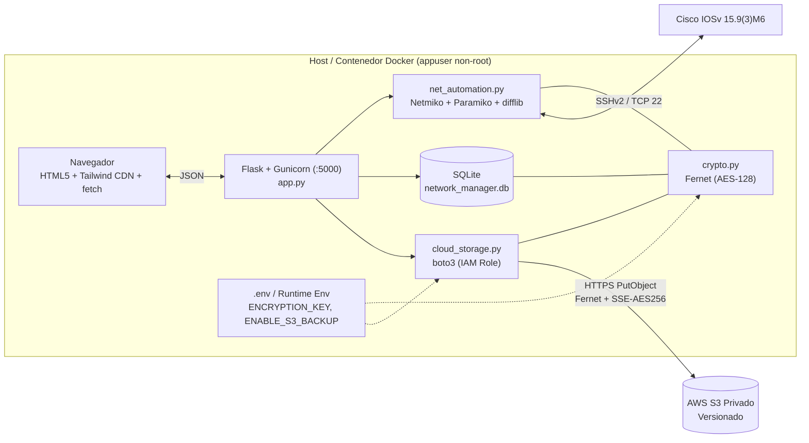
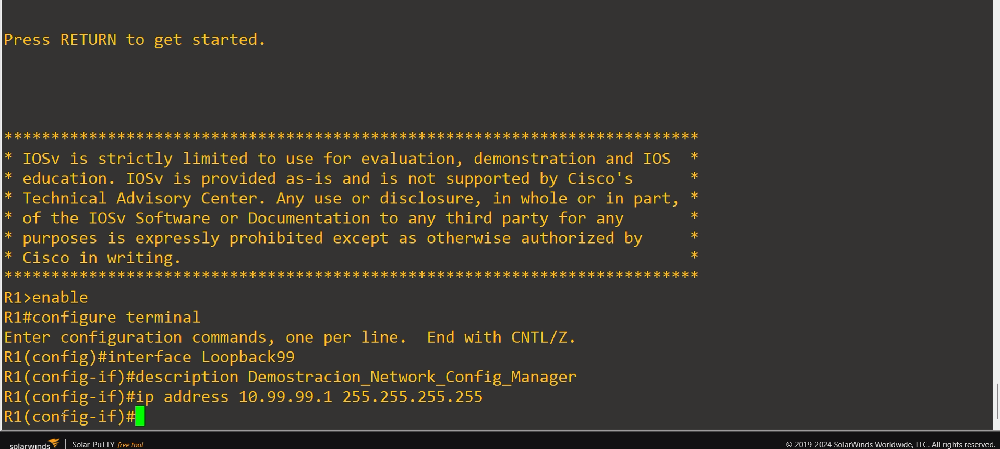
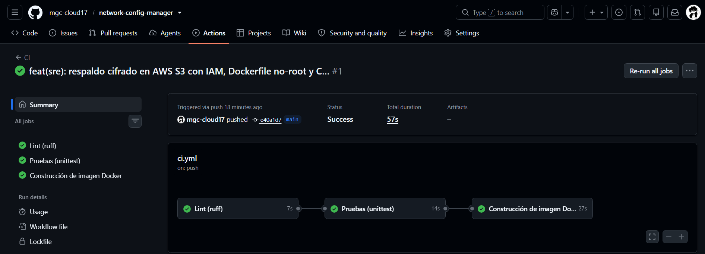

<div align="center">

# 🛰️ Network Config Manager

**Gestión automatizada de configuraciones para equipos Cisco IOS / IOSv: respaldos por SSHv2, auditoría con *diff* y *rollback* controlado, con credenciales cifradas en reposo.**


-2E7D32)


-2088FF?logo=githubactions&logoColor=white)

M6-049fd9?logo=cisco&logoColor=white)


</div>

---

## 1. Descripción ejecutiva

**Network Config Manager** es una aplicación web de NetDevOps/SRE para administrar el ciclo de vida de las configuraciones de routers y switches **Cisco IOS / IOSv**, preparada para despliegue en contenedores endurecidos e integración continua. Desde una única interfaz permite:

- **Inventariar** dispositivos, guardando su contraseña SSH y su *enable secret* **cifrados con Fernet** (nunca en texto plano).
- **Respaldar de forma híbrida (Local + AWS S3):** extrae el `running-config` en vivo por **SSHv2** (Netmiko/Paramiko), persiste primero en SQLite local y, si `ENABLE_S3_BACKUP=true`, sincroniza una copia **doblemente cifrada** (Fernet AES-128 + SSE-S3 AES256) hacia un bucket privado de **AWS S3** usando exclusivamente **IAM Roles** (con degradación elegante si S3 no está disponible).
- **Auditar cambios** comparando dos versiones con un *diff* unificado (`difflib`) calculado en el backend y resaltado en el navegador.
- **Restaurar (rollback)** una configuración anterior sobre el equipo real, con confirmación explícita y guardado en NVRAM (`write memory`).
- **Desplegar y validar automáticamente:** imagen **Docker endurecida** (`python:3.12-slim`, usuario no-root `appuser`, Gunicorn `--preload`) y pipeline **GitHub Actions CI** (`ruff` $\rightarrow$ `unittest` $\rightarrow$ `docker build`).

El proyecto se diseñó bajo una gobernanza explícita ([`RULES.md`](RULES.md) y [`ARCHITECTURE.md`](ARCHITECTURE.md)): frontend *zero-build*, consultas SQL parametrizadas, secretos fuera del repositorio y manejo explícito de errores de red.

---

## 2. Arquitectura y características clave



### 🔐 Cifrado de credenciales en reposo
- `encrypted_password` y `encrypted_secret` se almacenan como tokens **Fernet** (AES-128-CBC + HMAC-SHA256) mediante [`crypto.py`](crypto.py).
- La clave maestra `ENCRYPTION_KEY` vive **solo** en `.env` (excluido por `.gitignore`); el repositorio incluye únicamente [`.env.example`](.env.example).
- Las contraseñas se descifran **en memoria** justo antes de abrir la sesión SSH y se descartan al terminar (`finally`).
- La API **nunca** devuelve contraseñas ni *secrets*, ni en claro ni cifrados.
- `enable secret` es **opcional** por dispositivo.

### ⚙️ Motor de automatización SSHv2 (`net_automation.py`)
- Conexión con `ConnectHandler` (`device_type="cisco_ios"` por defecto), `fast_cli=False`, y `clear_buffer()` antes de operar.
- **Timeouts calibrados para IOSv real (QEMU):** `timeout`, `conn_timeout`, `auth_timeout` y `banner_timeout` = 30 s, `read_timeout_override` = 30 s, `global_delay_factor` = 2.0; `show running-config` con `read_timeout=30` y `send_config_set` con `read_timeout=60`.
- **Privilegios:** `enable()` solo se invoca si `not conn.check_enable_mode()`; con usuarios `privilege 15` (prompt `#`) no se pide contraseña de enable.
- **Compatibilidad con Cisco IOSv 15.9(3)M6:** este IOS solo ofrece algoritmos SHA-1 (`diffie-hellman-group14-sha1`, host key `ssh-rsa`). Las versiones recientes de Paramiko los eliminaron (verificado con 5.1.0: *"no acceptable kex algorithm"*), por lo que el proyecto fija **Paramiko 3.5.1**, que los conserva. Además se pasa `disabled_algorithms={"pubkeys": ["rsa-sha2-256", "rsa-sha2-512"]}`.
- **Funciones públicas:** `test_connection()`, `fetch_running_config()` (limpia las cabeceras volátiles `Building configuration...` y `Current configuration : ... bytes`), `apply_configuration()` (envía líneas con `send_config_set()` y guarda con `save_config()`) y `calculate_diff()`.
- **Errores explícitos:** `NetmikoAuthenticationException`, `NetmikoTimeoutException` (conservando el detalle original) y errores de transporte (`socket.error`, `OSError`, `EOFError`, `NetmikoBaseException` y `SSHException` de Paramiko) → `ConnectionError`. Ningún mensaje incluye credenciales.

### 🔍 Comparador de versiones y rollback
- `difflib.unified_diff(..., lineterm="")` en el backend, con normalización de saltos de línea (`\r\n` → `\n`).
- El navegador resalta adiciones (`+`, verde), supresiones (`-`, rojo), bloques (`@@`, azul) y muestra contadores de cambios.
- El *rollback* (desde la tabla de historial, el visor o el comparador) exige confirmar en un `<dialog>` modal nativo y reporta el resultado con notificaciones (*toasts*) y la salida CLI del equipo.

### 🎨 Frontend *zero-build*
- HTML5 semántico (`header`, `main`, `section`, `article`, `nav`, `dialog`, `table`, `form`), **Tailwind CSS vía CDN** y JavaScript nativo con **Fetch API**.
- Sin Node.js, npm, bundlers ni frameworks. El DOM se construye con `textContent`/`createElement` (sin inyectar HTML de datos remotos).
- Funciones: alta de dispositivos, prueba SSH, respaldo inmediato, visor monoespaciado del `running-config`, **copiar** al portapapeles y **descargar `.cfg`**.

### 🗄️ Persistencia y Respaldo Híbrido en AWS S3 (`cloud_storage.py`)
- **SQLite Local Primero:** `sqlite3` con `PRAGMA foreign_keys = ON`, **consultas parametrizadas (`?`)** y migración idempotente de columnas (`encrypted_secret`, `port` en `devices`; `s3_key`, `s3_version_id` en `backups`). Soporta ruta configurable mediante `DB_PATH`.
- **Doble Cifrado hacia AWS S3:** Cuando `ENABLE_S3_BACKUP=true`, [`cloud_storage.py`](cloud_storage.py) cifra el `running-config` en memoria con **Fernet (AES-128)** antes de salir del proceso (`crypto.encrypt_password()`) y lo sube con **SSE-S3 (`ServerSideEncryption="AES256"`)** a `backups/{hostname}/{timestamp}_backup_{backup_id}.enc`, registrando `s3_key` y `VersionId` en SQLite.
- **Cero Credenciales Hardcodeadas (IAM Roles):** El cliente `boto3.client("s3", region_name=...)` delega la autenticación exclusivamente a la cadena estándar de credenciales de AWS (IAM Instance Profile / ECS Task Role / entorno AWS); nunca recibe ni almacena `aws_access_key_id` o `aws_secret_access_key`.
- **Degradación Elegante (*Graceful Degradation*):** Si `ENABLE_S3_BACKUP=false` (por defecto), falta `AWS_S3_BUCKET`, u ocurre un `ClientError`, `NoCredentialsError` o fallo de red (`BotoCoreError`), el respaldo local en SQLite se conserva intacto y la API responde `201 Created` reportando el estado en `cloud_sync` sin devolver error `500`.

### 🐳 Contenedor Endurecido y Pipeline CI
- **Docker (`Dockerfile` + `.dockerignore`):** Basado en `python:3.12-slim`, ejecuta **Gunicorn** (`--preload -w 2 -b 0.0.0.0:5000 app:app`) bajo el usuario sin privilegios `appuser` (non-root) con directorio `/app/data` escribible para SQLite y exclusión estricta de `.env`, `*.db` y `venv/`.
- **GitHub Actions (`.github/workflows/ci.yml`):** En cada `push` o `pull_request` hacia `main`, valida tres etapas encadenadas: `lint` (`ruff check .`) $\rightarrow$ `test` (`unittest` con `ENCRYPTION_KEY` efímera) $\rightarrow$ `docker-build` (`docker build`).

---

## 3. Stack tecnológico

| Capa | Tecnología | Versión validada |
| :--- | :--- | :--- |
| Lenguaje | Python | 3.12.10 (`python:3.12-slim`) |
| Servidor web / WSGI | Flask / Gunicorn (Werkzeug / Jinja2) | 3.1.3 / 27.0.1 |
| Automatización de red | Netmiko | 4.8.0 |
| Transporte SSH | Paramiko | **3.5.1** (fijada por compatibilidad con IOSv) |
| Cifrado | `cryptography` (Fernet) | 50.0.2 |
| Almacenamiento Cloud | AWS S3 (`boto3`, IAM Roles, SSE-AES256) | 1.44.11 |
| Variables de entorno | python-dotenv | 1.2.4 |
| Persistencia | SQLite (`sqlite3` de la biblioteca estándar) | — |
| Comparación | `difflib` (biblioteca estándar) | — |
| Frontend | HTML5 + Tailwind CSS (CDN) + JavaScript nativo | — |
| Linting / CI | Ruff + GitHub Actions | 0.17.6 |
| Contenerización | Docker (non-root `appuser`) | — |
| Pruebas | `unittest` + `unittest.mock` | — |

### Entorno de laboratorio validado
- **GNS3** (cliente en Windows) + **GNS3 VM** sobre **VMware Workstation**.
- **Cisco IOSv 15.9(3)M6** accesible en `192.168.76.10`, SSHv2 en el puerto 22, usuario con `privilege 15`.

<details>
<summary>Preparación de referencia del router (IOS)</summary>

```
hostname R1
ip domain-name lab.local
crypto key generate rsa modulus 2048
ip ssh version 2
username admin privilege 15 secret <contraseña>
enable secret <secret>
line vty 0 4
 login local
 transport input ssh
```
</details>

---

## 4. Estructura del repositorio

```text
network-config-manager/
├── .github/
│   └── workflows/
│       └── ci.yml            # Pipeline CI: lint (ruff) -> test (unittest) -> docker-build
├── app.py                    # Servidor Flask y API REST (puerto 5000)
├── cloud_storage.py          # Respaldo híbrido AWS S3 (Fernet + SSE-AES256, IAM Role)
├── database.py               # Capa de acceso a datos SQLite (DAL, migraciones, consultas ?)
├── net_automation.py         # Netmiko/Paramiko: test, backup, apply_configuration, difflib
├── crypto.py                 # Cifrado/descifrado Fernet (lee ENCRYPTION_KEY de .env)
├── templates/
│   └── index.html            # Interfaz web (HTML5 + Tailwind CDN + JS nativo + insignia S3)
├── docs/
│   └── images/               # Capturas de pantalla de la demostración end-to-end (5 PNG)
├── test_api.py               # Pruebas de integración de la API Flask (9)
├── test_cloud_storage.py     # Pruebas con mocks de AWS S3 y degradación elegante (11)
├── test_db_crypto.py         # Pruebas de persistencia, cifrado y migraciones (9)
├── test_net_automation.py    # Pruebas con mocks del motor de red y del diff (17)
├── test_db.py                # Script de verificación rápida de SQLite + Fernet
├── Dockerfile                # Imagen endurecida python:3.12-slim + appuser + Gunicorn
├── .dockerignore             # Excluye .env, *.db, venv/, __pycache__/ y .git/
├── requirements.txt          # Dependencias fijadas (incluye paramiko==3.5.1, boto3, gunicorn, ruff)
├── ruff.toml                 # Configuración de análisis estático Ruff (py312)
├── ARCHITECTURE.md           # Topología, modelo de datos, contratos y flujo
├── RULES.md                  # Reglas de gobernanza técnica
├── .env.example              # Plantilla de variables de entorno (Fernet + AWS S3)
├── .gitignore                # Excluye .env, *.db, venv/ y __pycache__/
├── .specify/                 # Especificaciones y plantillas Spec Kit
│   └── specs/
│       ├── 01-database-and-inventory.md
│       └── 02-network-automation.md
├── specs/                    # Especificación, plan y tareas de Evolución SRE/Cloud
│   └── 001-sre-cloud-evolution/
│       ├── spec.md
│       ├── plan.md
│       └── tasks.md
└── .agents/skills/           # Skills de Spec Kit para asistentes de IA
```

Archivos generados localmente y **no versionados**: `.env`, `network_manager.db` y `venv/`.

---

## 5. Instalación y ejecución local

> Requisitos: **Python 3.12** y **Git**.

### Windows (PowerShell)

```powershell
# 1. Clonar y entrar al proyecto
git clone https://github.com/mgc-cloud17/network-config-manager.git
cd network-config-manager

# 2. Entorno virtual (si PowerShell bloquea el script: Set-ExecutionPolicy -Scope Process Bypass)
python -m venv venv
.\venv\Scripts\Activate.ps1

# 3. Dependencias
python -m pip install --upgrade pip
pip install -r requirements.txt

# 4. Clave Fernet en .env (a partir de .env.example)
Copy-Item .env.example .env
$key = python -c "from cryptography.fernet import Fernet; print(Fernet.generate_key().decode())"
(Get-Content .env) -replace 'genera_tu_propia_llave_fernet_aqui', $key | Set-Content .env -Encoding ascii

# 5. Pruebas
python -m unittest discover -s . -p "test_*.py" -v

# 6. Servidor
python app.py
```

### Linux / macOS (bash/zsh)

```bash
# 1. Clonar y entrar al proyecto
git clone https://github.com/mgc-cloud17/network-config-manager.git
cd network-config-manager

# 2. Entorno virtual
python3.12 -m venv venv
source venv/bin/activate

# 3. Dependencias
python -m pip install --upgrade pip
pip install -r requirements.txt

# 4. Clave Fernet en .env (a partir de .env.example)
cp .env.example .env
KEY=$(python -c "from cryptography.fernet import Fernet; print(Fernet.generate_key().decode())")
python - "$KEY" <<'PY'
import sys, pathlib
p = pathlib.Path(".env")
p.write_text(p.read_text().replace("genera_tu_propia_llave_fernet_aqui", sys.argv[1]))
PY

# 5. Pruebas
python -m unittest discover -s . -p "test_*.py" -v

# 6. Servidor
python app.py
```

Abre **http://127.0.0.1:5000**, registra tu router (por ejemplo `192.168.76.10`, puerto `22`) y usa **Probar SSH** → **Respaldar** → **Comparar** → **Rollback**.

> ⚠️ **Conserva tu `ENCRYPTION_KEY`.** Si la cambias o la pierdes, las contraseñas ya almacenadas no podrán descifrarse (`InvalidToken`) y habrá que volver a registrar los dispositivos.

### Variables de Entorno AWS S3 (Respaldo Híbrido Opcional)

| Variable | Valor por defecto | Descripción |
| :--- | :--- | :--- |
| `ENCRYPTION_KEY` | *(obligatoria)* | Clave Fernet de 32 bytes en Base64 URL-safe usada para credenciales y doble cifrado S3. |
| `ENABLE_S3_BACKUP` | `false` | Activa (`true`) o desactiva (`false`) la sincronización automática hacia AWS S3 al respaldar. |
| `AWS_S3_BUCKET` | `tu-bucket-privado-network-backups` | Nombre del bucket privado S3 de destino (con versionado recomendado). |
| `AWS_REGION` | `us-east-1` | Región AWS pasada a `boto3.client("s3", region_name=...)`. |
| `DB_PATH` | `network_manager.db` | Ruta opcional de la base de datos SQLite (en Docker apunta a `/app/data/network_manager.db`). |

> 🔐 **Autenticación IAM:** Nunca definas `aws_access_key_id` ni `aws_secret_access_key` en el código. Asigna un **IAM Role** con permiso `s3:PutObject` sobre `arn:aws:s3:::<tu-bucket>/backups/*` (o usa la cadena estándar de credenciales AWS del entorno).

### Ejecución con Docker (Contenedor Endurecido)

El contenedor corre bajo el usuario sin privilegios **`appuser`** con **Gunicorn** (`--preload -w 2 -b 0.0.0.0:5000`) y excluye `.env`, `*.db` y `venv/` mediante `.dockerignore`:

```bash
# 1. Construir la imagen
docker build -t network-config-manager:local .

# 2. Verificar que el contenedor corre sin privilegios de root
docker run --rm --entrypoint id network-config-manager:local
# Esperado: uid=1000(appuser) gid=1000(appuser) ...

# 3. Ejecutar con volumen persistente para SQLite e inyección de variables en runtime
docker run -d --name net-conf-manag \
  -p 5000:5000 \
  -v netconf_data:/app/data \
  -e ENCRYPTION_KEY="<tu-clave-fernet>" \
  -e ENABLE_S3_BACKUP="false" \
  network-config-manager:local
```

> Para habilitar AWS S3 desde el contenedor en ECS/EC2/EKS, asigna el IAM Role correspondiente a la tarea/instancia y añade `-e ENABLE_S3_BACKUP=true -e AWS_S3_BUCKET=<tu-bucket> -e AWS_REGION=us-east-1`.

---

## 6. API REST

Todas las respuestas son JSON con la forma `{"status": "success" | "error", "message": ..., "data": ...}`. Los errores de red del equipo se traducen así: autenticación → `401`, timeout → `504`, transporte/otros → `502`.

| Método | Ruta | Descripción | Parámetros / payload | Códigos |
| :--- | :--- | :--- | :--- | :--- |
| `GET` | `/` | Sirve la interfaz web (`templates/index.html`). | — | `200` |
| `GET` | `/api/devices` | Lista el inventario con el resumen de sus respaldos (`id`, `timestamp`, `size_bytes`). Sin credenciales. | — | `200` |
| `POST` | `/api/devices` | Registra un dispositivo; cifra `password` y `secret` con Fernet. | JSON: `hostname` (o `name`), `ip_address`, `username`, `password` (obligatorios); `device_type` (def. `cisco_ios`), `port` (def. `22`, 1–65535), `secret` (opcional) | `201` creado · `400` JSON/campos/IP/puerto inválidos · `409` IP duplicada |
| `DELETE` | `/api/devices/<id>` | Elimina el dispositivo y sus respaldos (cascada). | Ruta: `id` (entero) | `200` · `404` |
| `POST` | `/api/devices/<id>/test` | Prueba SSH (y `enable` si hay *secret*) con `test_connection()`. | Ruta: `id` | `200` `connected: true` · `404` · `502` `connected: false` |
| `POST` | `/api/devices/<id>/backup` | Extrae el `running-config` en vivo, guarda en SQLite y sincroniza copia cifrada en S3 si `ENABLE_S3_BACKUP=true` (degrada con `201` si S3 falla). | Ruta: `id` | `201` (`id`, `timestamp`, `size_bytes`, `config_text`, `s3_key`, `s3_version_id`, `cloud_sync`) · `404` · `401` · `504` · `502` |
| `GET` | `/api/devices/<id>/backups` | Historial de respaldos del dispositivo (incluye `s3_key`, `s3_version_id`, más reciente primero). | Ruta: `id` | `200` · `404` |
| `GET` | `/api/backups/<id>` | Contenido completo de un respaldo (`config_text`, `s3_key`, `s3_version_id`). | Ruta: `id` del respaldo | `200` · `404` |
| `GET` | `/api/devices/<id>/diff` | *Diff* unificado entre dos respaldos del dispositivo (`has_changes`, `diff_lines`, `unified_diff`). | Query: `v1`, `v2` (IDs de respaldo, obligatorios y enteros) | `200` · `400` · `404` |
| `POST` | `/api/devices/<id>/rollback/<backup_id>` | Aplica el respaldo al equipo con `apply_configuration()` y guarda en NVRAM. | Ruta: `id`, `backup_id` | `200` (`commands_applied`, `output`) · `404` · `401` · `504` · `502` |

**Ejemplo — registrar un dispositivo**

```bash
curl -X POST http://127.0.0.1:5000/api/devices \
  -H "Content-Type: application/json" \
  -d '{"hostname":"R1","ip_address":"192.168.76.10","port":22,"device_type":"cisco_ios","username":"admin","password":"<contraseña>","secret":"<secret>"}'
```

---

## 7. Pruebas y validación en laboratorio

### Suite automatizada — 46 pruebas `unittest` y linting `ruff`

```bash
ruff check .
python -m unittest discover -s . -p "test_*.py" -v
```

| Archivo | Pruebas | Cobertura |
| :--- | :---: | :--- |
| [`test_db_crypto.py`](test_db_crypto.py) | 9 | Contraseña **no** presente en texto plano en la BD ni en los bytes del archivo `.db`; ida y vuelta Fernet; ocultamiento de credenciales en consultas; rechazo de tokens manipulados (HMAC); neutralización de inyección SQL; borrado en cascada; cifrado de `encrypted_secret`; *secret* opcional y migración idempotente de tablas heredadas (`devices` y columnas `s3_key`/`s3_version_id` en `backups`). |
| [`test_net_automation.py`](test_net_automation.py) | 17 | Con *mocks* de Netmiko: `test_connection`, `fetch_running_config` (limpieza de cabeceras, parámetros de conexión, `enable()` condicional con `privilege 15`), `apply_configuration` (filtrado de comandos, `send_config_set` + `save_config`), errores de autenticación/timeout/socket/`SSHException`, sin fuga de credenciales y `calculate_diff` (marcadores `+`/`-`, configuraciones idénticas). |
| [`test_cloud_storage.py`](test_cloud_storage.py) | 11 | Con *mocks* de `boto3.client`: omisión cuando `ENABLE_S3_BACKUP=false`, validación de `AWS_S3_BUCKET`, cifrado previo con Fernet sin texto plano, `ServerSideEncryption="AES256"`, captura de `VersionId`, sanitización de `hostname` en `s3_key`, degradación elegante ante `ClientError`/`NoCredentialsError`/red y verificación de cero credenciales estáticas AWS en el código fuente. |
| [`test_api.py`](test_api.py) | 9 | Cliente de pruebas de Flask con BD temporal: las 10 rutas, códigos de error, ausencia de credenciales en las respuestas, persistencia de `cloud_sync`/`s3_key`/`s3_version_id` en `/backup` y degradación elegante (`HTTP 201`) cuando S3 falla o está deshabilitado. |
| [`test_db.py`](test_db.py) | script | Verificación rápida (`python test_db.py`) con la BD real: inserta un router con *password* y *secret*, confirma el cifrado, descifra y borra el registro. |

> `test_db.py` opera sobre `network_manager.db` (crea la base si no existe y elimina el registro de prueba al terminar).

### Escenario real contra Cisco IOSv

Flujo funcional contra el laboratorio **GNS3 + GNS3 VM (VMware Workstation) con Cisco IOSv 15.9(3)M6 en `192.168.76.10`** (SSHv2, puerto 22, usuario `privilege 15` y *enable secret*):

1. Registrar el router desde la interfaz (credenciales cifradas con Fernet en SQLite).
2. **Probar SSH** (`POST /api/devices/<id>/test`).
3. **Respaldar** el `running-config` (`POST /api/devices/<id>/backup`) y consultarlo en el visor.
4. Modificar la configuración del router, generar un segundo respaldo y **comparar** ambas versiones (`GET /api/devices/<id>/diff`).
5. **Rollback** a la versión anterior con confirmación (`POST /api/devices/<id>/rollback/<backup_id>`).

La compatibilidad SSH se verificó con una negociación real contra el equipo: Paramiko 3.5.1 acuerda host key `ssh-rsa`, cifrado `aes128-ctr` y MAC `hmac-sha2-256`, mientras que Paramiko 5.1.0 falla con `no acceptable kex algorithm`.

---

## 8. Demostración Visual del Flujo End-to-End

A continuación se documenta el recorrido completo de **Network Config Manager** ejecutado contra un router **Cisco IOSv 15.9(3)M6** en GNS3 (`192.168.76.10`) y su validación automatizada en **GitHub Actions**:

### 1. Inventario de Dispositivos y Cifrado Fernet
Alta del router Cisco IOSv (`192.168.76.10`) cifrando credenciales SSH y *enable secret* en reposo con Fernet (AES-128), y validación de conectividad SSHv2 en tiempo real desde el panel web.


### 2. Captura de Respaldos Versionados
Extracción automatizada del `running-config` vía Netmiko (`read_timeout=30`), limpieza de cabeceras volátiles de IOS y persistencia versionada en SQLite (con sincronización híbrida cifrada hacia AWS S3 cuando `ENABLE_S3_BACKUP=true`).


### 3. Modificación en Vivo en Cisco IOSv (GNS3)
Cambio aplicado directamente en la CLI del router (`Loopback99`) mediante terminal SSH/PuTTY para simular una modificación fuera de banda y auditar la deriva de configuración (*configuration drift*).



### 4. Auditoría Visual Diff y Rollback
Comparación línea por línea entre versiones calculada en el backend con `difflib.unified_diff` (resaltando adiciones `+` en verde y supresiones `-` en rojo) y flujo de restauración automatizada (*rollback*) al estado base con confirmación modal.


### 5. Pipeline CI/CD en GitHub Actions
Ejecución automática en tres etapas encadenadas ante cada `push` o `pull_request` a `main`: análisis estático con `ruff`, suite completa de **46 pruebas unitarias (`unittest`)** con `ENCRYPTION_KEY` efímera y construcción verificada de la imagen Docker endurecida (`appuser`).



---

## 9. Consideraciones y limitaciones conocidas

- **Alcance de laboratorio.** La API **no tiene autenticación** y `app.py` escucha en `0.0.0.0:5000` (servidor de desarrollo de Flask, `debug=False`). Úsalo en una red de laboratorio de confianza, o cambia el `host` a `127.0.0.1` o restríngelo con un firewall antes de exponerlo.
- **El rollback es aditivo.** `apply_configuration()` envía las líneas del respaldo (sin comentarios `!`, cabeceras ni `end`) con `send_config_set()`; **no elimina** las líneas añadidas después del respaldo. Revisa el *diff* antes de restaurar.
- **Los respaldos se guardan tal cual.** `raw_config` no se cifra; un `running-config` puede contener *hashes* de contraseñas, comunidades SNMP u otros datos sensibles. Protege el archivo `network_manager.db` (ya excluido de Git).
- **Sin verificación de *host key* SSH.** Netmiko usa por defecto una política permisiva (`ssh_strict=False`).
- **Dependencia fijada.** Paramiko debe permanecer en **3.5.1** mientras se gestionen equipos IOS/IOSv que solo ofrecen algoritmos SHA-1.
- **Gobernanza.** Las reglas del proyecto están en [`RULES.md`](RULES.md); la topología, el modelo de datos y el flujo, en [`ARCHITECTURE.md`](ARCHITECTURE.md).
