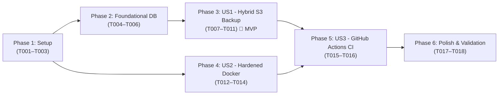

---

description: "Desglose atómico y ordenado de tareas para la evolución SRE/Cloud de Network Config Manager"
---

# Tasks: Evolución SRE/Cloud (Respaldo Híbrido S3, Contenedor Endurecido y CI)

**Input**: Design documents from `/specs/001-sre-cloud-evolution/` (`plan.md`, `spec.md`, `research.md`, `data-model.md`, `contracts/api-and-cloud-contracts.md`, `quickstart.md`)

**Prerequisites**: `plan.md` (requerido), `spec.md` (historias P1–P3), `data-model.md`, `contracts/api-and-cloud-contracts.md`

**Tests**: Incluidas explícitamente (`test_cloud_storage.py`, ampliación de `test_db_crypto.py` y `test_api.py`, más limpieza integral con `ruff`).

**Organization**: Tareas agrupadas por historia de usuario para permitir implementación, validación e incremento independiente sin romper las 31 pruebas existentes ni las reglas de `RULES.md`.

## Format: `[ID] [P?] [Story] Description`

- **[P]**: Ejecutable en paralelo (archivos distintos, sin dependencias de tareas incompletas)
- **[Story]**: Historia de usuario asociada (`[US1]`, `[US2]`, `[US3]`)
- Todas las tareas incluyen rutas exactas relativas a la raíz del repositorio (`net-conf-manag/`)

---

## Phase 1: Setup (Shared Infrastructure & Dependencies)

**Purpose**: Formalizar dependencias fijadas (preservando compatibilidad con Cisco IOSv 15.9(3)M6) y variables de entorno desacopladas.

- [X] T001 Crear `requirements.txt` en la raíz del proyecto fijando `Flask==3.1.3`, `netmiko==4.8.0`, `paramiko==3.5.1`, `cryptography==50.0.2`, `python-dotenv==1.2.4`, `boto3`, `gunicorn` y `ruff`
- [X] T002 [P] Actualizar `.env.example` añadiendo `ENABLE_S3_BACKUP=false`, `AWS_S3_BUCKET=tu-bucket-privado-network-backups` y `AWS_REGION=us-east-1` sin incluir `aws_access_key_id` ni `aws_secret_access_key`
- [X] T003 Instalar y verificar los paquetes declarados en `requirements.txt` dentro del entorno virtual local (`venv/`)

---

## Phase 2: Foundational (Blocking Prerequisites — SQLite Schema & DAL)

**Purpose**: Extender de forma idempotente la capa de persistencia SQLite para soportar metadatos de AWS S3 sin afectar los registros ni pruebas existentes.

**⚠️ CRITICAL**: Debe completarse antes de iniciar las fases de historias de usuario.

- [X] T004 Actualizar `init_db()` en `database.py` para definir `s3_key TEXT DEFAULT NULL` y `s3_version_id TEXT DEFAULT NULL` en `CREATE TABLE IF NOT EXISTS backups` y ejecutar migración idempotente inspeccionando `PRAGMA table_info(backups);` (`ALTER TABLE backups ADD COLUMN s3_key TEXT DEFAULT NULL;` y `ALTER TABLE backups ADD COLUMN s3_version_id TEXT DEFAULT NULL;`)
- [X] T005 Implementar `update_backup_s3_metadata(backup_id: int, s3_key: str, s3_version_id: Optional[str] = None, db_path: str = DEFAULT_DB_PATH) -> bool` con query parametrizado `?` (`UPDATE backups SET s3_key = ?, s3_version_id = ? WHERE id = ?;`) e incluir `s3_key` y `s3_version_id` en `get_devices()`, `get_device_backups()` y `get_backup_by_id()` dentro de `database.py`
- [X] T006 Añadir pruebas unitarias en `test_db_crypto.py` verificando la migración idempotente de una tabla `backups` heredada sin columnas S3 y la persistencia/lectura exacta mediante `update_backup_s3_metadata()`

**Checkpoint**: Esquema SQLite migrado y retrocompatible; las pruebas base de persistencia pasan al 100%.

---

## Phase 3: User Story 1 - Respaldo Híbrido Versionado en AWS S3 con Doble Cifrado y Degradación Elegante (Priority: P1) 🎯 MVP

**Goal**: Al ejecutar `POST /api/devices/<device_id>/backup`, guardar primero el respaldo en SQLite local y, cuando `ENABLE_S3_BACKUP=true`, subir una copia doblemente cifrada (Fernet + `SSE-AES256`) a AWS S3 autenticándose exclusivamente por IAM Role, registrando `s3_key` y `s3_version_id` y degradando con elegancia (`HTTP 201`) ante cualquier fallo cloud.

**Independent Test**: Ejecutar `python -m unittest test_cloud_storage.py test_api.py -v` verificando modo deshabilitado (`ENABLE_S3_BACKUP=false`), subida cifrada con mock de `boto3`, persistencia de `VersionId`/`s3_key` en SQLite y respuesta `HTTP 201` intacta cuando S3 lanza `ClientError`.

### Tests for User Story 1 ⚠️

> **NOTE: Escribir estas pruebas PRIMERO y confirmar que fallan antes de implementar `cloud_storage.py` y la integración en `app.py`.**

- [X] T007 [P] [US1] Crear `test_cloud_storage.py` con `unittest.mock` (`patch("cloud_storage.boto3.client")` y variables de entorno simuladas) validando: `ENABLE_S3_BACKUP=false` omite S3; ausencia de `AWS_S3_BUCKET` retorna error controlado; subida exitosa cifra con `crypto.encrypt_password()`, usa `ServerSideEncryption="AES256"`, genera ruta `backups/{hostname}/{timestamp}_backup_{backup_id}.enc` con `hostname` sanitizado, captura `VersionId` (presente o `None`) y no pasa `aws_access_key_id`/`aws_secret_access_key`; captura de `ClientError` y `BotoCoreError` retorna `synced=False` sin lanzar excepción
- [X] T008 [P] [US1] Ampliar `test_api.py` con casos para `POST /api/devices/<int:device_id>/backup` verificando que incluye `cloud_sync` (`{"synced": bool, "s3_key": str | None, "version_id": str | None, "error": str | None}`) en `HTTP 201`, actualiza `s3_key`/`s3_version_id` en SQLite cuando `synced=True` y conserva el respaldo local sin devolver `HTTP 500` cuando S3 falla

### Implementation for User Story 1

- [X] T009 [US1] Crear `cloud_storage.py` implementando `upload_encrypted_backup(hostname: str, backup_id: int, config_text: str) -> dict` con lectura dinámica de `ENABLE_S3_BACKUP`, `AWS_S3_BUCKET` y `AWS_REGION`, sanitización de `hostname`, cifrado en memoria con `crypto.encrypt_password()`, cliente IAM `boto3.client("s3", region_name=aws_region)`, `put_object(..., ServerSideEncryption="AES256")` y captura explícita de `(ClientError, BotoCoreError, Exception)` devolviendo `{"synced": bool, "s3_key": str | None, "version_id": str | None, "error": str | None}`
- [X] T010 [US1] Actualizar `create_device_backup()` y `get_backup_detail()` en `app.py` para invocar `upload_encrypted_backup()` inmediatamente después de `add_backup()`, persistir `s3_key` y `s3_version_id` con `update_backup_s3_metadata()` si `cloud_sync["synced"]` es `True`, y retornar `s3_key`, `s3_version_id` y `cloud_sync` dentro de `data` con estado `HTTP 201`
- [X] T011 [P] [US1] Actualizar `templates/index.html` (HTML5 semántico + Tailwind CSS CDN + JS nativo) para mostrar una insignia discreta de sincronización S3 en el historial de respaldos cuando `s3_key` esté presente y notificar en el *toast* si el respaldo quedó solo local o sincronizado en S3 (o con advertencia si `cloud_sync.error` existe)

**Checkpoint**: User Story 1 completamente funcional y verificable de forma independiente (MVP Cloud Hybrid Backup listo).

---

## Phase 4: User Story 2 - Contenerización Endurecida para Despliegue Portátil (Priority: P2)

**Goal**: Empaquetar la aplicación en una imagen Docker basada en `python:3.12-slim` ejecutándose bajo el usuario sin privilegios `appuser` con Gunicorn en el puerto `5000`, sin secretos ni artefactos locales en el contexto de build.

**Independent Test**: Construir la imagen con `docker build -t network-config-manager:local .`, verificar que `id` reporte `appuser` (no-root), que no existan `.env`, `*.db` ni `venv/` en `/app`, y que Gunicorn responda `HTTP 200` en `http://127.0.0.1:5000`.

### Implementation for User Story 2

- [X] T012 [P] [US2] Crear `.dockerignore` en la raíz del proyecto excluyendo `.env`, `*.key`, `*.db`, `*.sqlite`, `*.sqlite3`, `venv/`, `__pycache__/`, `*.py[cod]`, `.git/`, `.specify/`, `.agents/` y `specs/`
- [X] T013 [P] [US2] Permitir sobreescribir la ruta por defecto de SQLite mediante la variable de entorno opcional `DB_PATH` en `database.py` (`DEFAULT_DB_PATH = os.environ.get("DB_PATH") or str(Path(__file__).resolve().parent / "network_manager.db")`) manteniendo el comportamiento actual cuando `DB_PATH` no está definida
- [X] T014 [US2] Crear `Dockerfile` en la raíz del proyecto usando `FROM python:3.12-slim`, `ENV PYTHONDONTWRITEBYTECODE=1 PYTHONUNBUFFERED=1 DB_PATH=/app/data/network_manager.db`, instalación con `pip install --no-cache-dir -r requirements.txt`, creación de `useradd --create-home appuser`, directorio `/app/data` con `chown -R appuser:appuser /app`, directiva `USER appuser`, `EXPOSE 5000` y `CMD ["gunicorn", "-w", "2", "-b", "0.0.0.0:5000", "app:app"]`

**Checkpoint**: Imagen Docker endurecida y reproducible lista para despliegue local o cloud.

---

## Phase 5: User Story 3 - Pipeline de Integración Continua (CI) en GitHub Actions (Priority: P3)

**Goal**: Automatizar en cada `push` o `pull_request` hacia `main` la validación secuencial de análisis estático (`ruff`), suite completa de pruebas (`unittest` con `ENCRYPTION_KEY` efímera) y construcción verificada de la imagen Docker.

**Independent Test**: Ejecutar localmente `ruff check .` y `python -m unittest discover -s . -p "test_*.py" -v` sin errores y validar la sintaxis y encadenamiento (`needs`) de `.github/workflows/ci.yml`.

### Implementation for User Story 3

- [X] T015 [US3] Ejecutar `ruff check .` sobre todo el repositorio (`app.py`, `cloud_storage.py`, `crypto.py`, `database.py`, `net_automation.py`, `test_api.py`, `test_cloud_storage.py`, `test_db.py`, `test_db_crypto.py`, `test_net_automation.py`) y limpiar cualquier advertencia de linting, imports no utilizados o formato manteniendo intactos los contratos existentes
- [X] T016 [US3] Crear `.github/workflows/ci.yml` configurado para `push` y `pull_request` hacia `main` con tres jobs encadenados en `ubuntu-latest`: `lint` (`ruff check .`), `test` (`needs: lint`, instala `requirements.txt`, inyecta `ENCRYPTION_KEY` efímera generada con `Fernet.generate_key()` y ejecuta `python -m unittest discover -s . -p "test_*.py" -v`) y `docker-build` (`needs: test`, ejecuta `docker build -t network-config-manager:ci .`)

**Checkpoint**: Repositorio limpio bajo `ruff` y pipeline CI de 3 etapas operativo.

---

## Phase 6: Polish & Cross-Cutting Concerns

**Purpose**: Sincronizar documentación técnica y ejecutar la verificación integral de extremo a extremo.

- [X] T017 [P] Actualizar `ARCHITECTURE.md` y `README.md` incorporando la arquitectura de respaldo híbrido S3 (`cloud_storage.py`), las variables `ENABLE_S3_BACKUP` / `AWS_S3_BUCKET` / `AWS_REGION`, las instrucciones de contenedor Docker endurecido y el estado del pipeline CI
- [X] T018 Ejecutar validación final completa según `specs/001-sre-cloud-evolution/quickstart.md`: `ruff check .`, `python -m unittest discover -s . -p "test_*.py" -v`, `python test_db.py` y auditoría de cero credenciales estáticas AWS en el código fuente

---

## Dependencies & Execution Order

### Phase Dependencies

- **Phase 1 (Setup)**: Sin dependencias — inicia de inmediato (`T001`–`T003`).
- **Phase 2 (Foundational)**: Depende de Phase 1 — bloquea `US1` por el esquema `s3_key`/`s3_version_id` en `database.py` (`T004`–`T006`).
- **Phase 3 (User Story 1 - P1 🎯 MVP)**: Depende de Phase 2 (`T007`–`T011`).
- **Phase 4 (User Story 2 - P2)**: Depende de `T001` (`requirements.txt`) y puede avanzar en paralelo con `US1`, consolidando la imagen final tras `T010` (`T012`–`T014`).
- **Phase 5 (User Story 3 - P3)**: Depende de `US1` y `US2` para que `ruff check .`, `unittest` y `docker build` validen el repositorio completo (`T015`–`T016`).
- **Phase 6 (Polish)**: Depende de completar las fases anteriores (`T017`–`T018`).

### User Story Dependencies



---

## Parallel Opportunities

### Parallel Example: Setup & Foundational
```text
Task T001: "Crear requirements.txt en la raíz del proyecto..."
Task T002: "Actualizar .env.example añadiendo ENABLE_S3_BACKUP, AWS_S3_BUCKET y AWS_REGION..."
```

### Parallel Example: User Story 1 (Tests First)
```text
Task T007: "Crear test_cloud_storage.py con unittest.mock..."
Task T008: "Ampliar test_api.py con casos para POST /api/devices/<id>/backup y cloud_sync..."
```

### Parallel Example: User Story 2 (Container Hardening)
```text
Task T012: "Crear .dockerignore en la raíz del proyecto..."
Task T013: "Permitir sobreescribir la ruta por defecto de SQLite mediante DB_PATH en database.py..."
```

---

## Implementation Strategy

### MVP First (User Story 1)
1. Completar **Phase 1: Setup** (`T001`–`T003`) y **Phase 2: Foundational** (`T004`–`T006`).
2. Escribir pruebas `T007` y `T008` y verificar que fallan antes de implementar.
3. Implementar `cloud_storage.py` (`T009`), integrar en `app.py` (`T010`) y actualizar el indicador en `templates/index.html` (`T011`).
4. **Validar MVP**: Confirmar que todas las pruebas nuevas y las 31 existentes pasan sin errores.

### Incremental Delivery
1. **Incremento 1 (`US1`):** Respaldo híbrido S3 con doble cifrado, IAM y degradación elegante.
2. **Incremento 2 (`US2`):** Contenedor endurecido `python:3.12-slim` + `appuser` + Gunicorn.
3. **Incremento 3 (`US3` + `Polish`):** Limpieza `ruff`, pipeline GitHub Actions (`.github/workflows/ci.yml`) y documentación actualizada.
